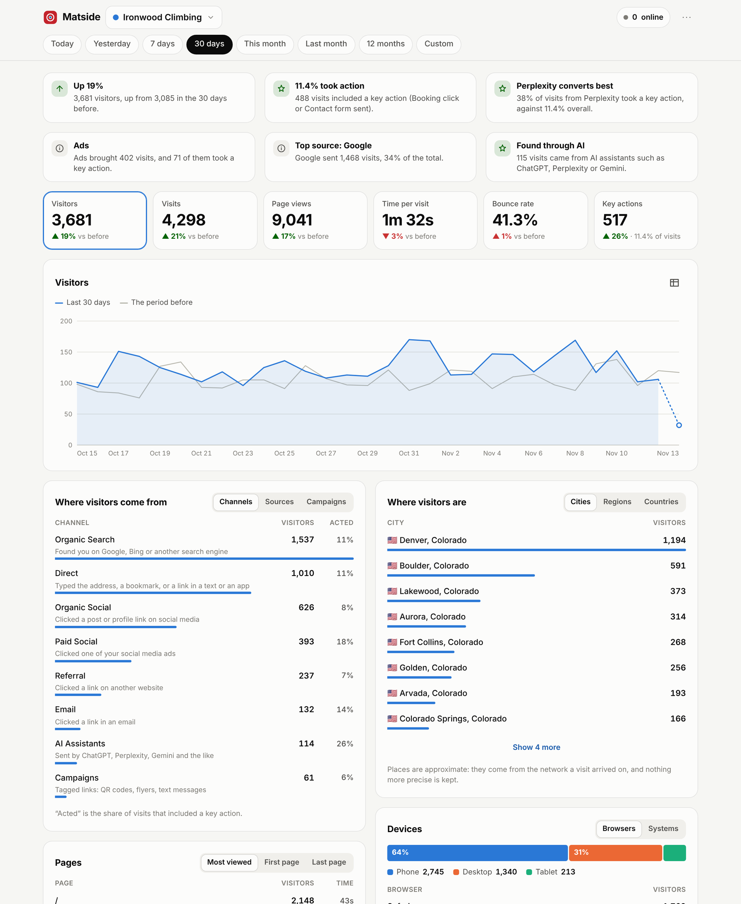
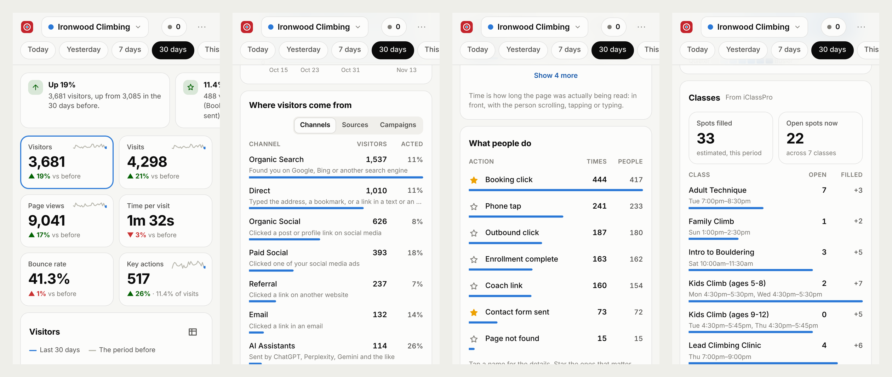
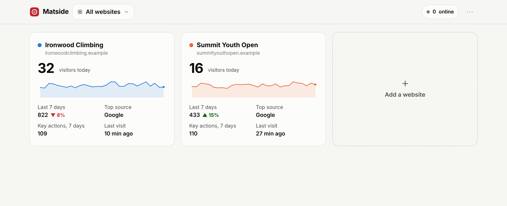

# Matside

**Website numbers a business owner can read on a phone.** One Cloudflare Worker, one small database, no cookies, no build step, free to run.

Matside started as the dashboard for a youth wrestling academy. The owner did not want "sessions by default channel grouping". He wanted to open his phone between practices and see: how many people came, where they came from, whether they clicked Register, which coach videos they watched, and whether the ads were worth it. Matside answers those in sentences first and charts second.





## What you get

**Plain-English answers.** The top of every page says what happened: "Up 16% on the 30 days before", "Perplexity converts best", "Tuesdays around 8 pm bring the most visits", "12 visits landed on a page that does not exist". Every sentence is a rule over the numbers, not a guess.

**The numbers that matter, against the period before.** Visitors, visits, page views, time actually spent reading, bounce rate and key actions, each with its change and a trend line. Tap any row (a source, a page, a city, a device) to filter the whole page by it.

**Actions, not just page views.** Out of the box: clicks on outside links, phone and email taps, file downloads, form submits, and video plays with real watch time (HTML `<video>` and YouTube embeds). Name anything else with one attribute:

```html
<a href="/signup" data-m="Sign-up click" data-m-plan="Family">Join</a>
```

Star the actions that matter and they become **key actions**: your conversion rate, per source, per campaign.

**Where people come from, in words.** Search, social, email, ads, other websites, tagged links (QR codes, flyers) and **AI assistants** (ChatGPT, Perplexity, Gemini, Claude, Copilot) each get their own line, with a one-sentence explanation of what the word means.

**The journey.** Choose a few steps ("saw a program page", "clicked Register") and see how many visits make it through each one.

**Several websites, one dashboard.** An overview card per site, and a switcher. Adding a site is a name, an address and one line of HTML.

**Business data next to traffic.** Integrations are small modules. Two ship with it:

- **iClassPro**: open spots per class, and an estimate of spots filled, with no login (it reads the public class list).
- **Meta ads**: what each campaign cost next to the visits and key actions it brought.

**Follows a visitor across domains without cookies.** If your site hands people to a booking or checkout portal on another domain, the same visit continues there (see [how it counts](docs/how-it-counts.md)).

**Private by design.** No cookies, nothing stored on a visitor's device, no fingerprinting, no IP addresses kept. Visitors are counted with a short hash that changes every day; its key is deleted within two days, after which nobody can work back from it. The snippet sends the page address without its query string, and never anything typed into a form.

**Built for the free plan.** Static files are served by Cloudflare without running any code. Daily summaries mean a 12-month view costs about what a 1-day view does.



## Set it up

You need a free [Cloudflare](https://dash.cloudflare.com/sign-up) account and Node 20 or newer.

[](https://deploy.workers.cloudflare.com/?url=https://github.com/aChubbyNinja/matside)

The button copies this repository to your own account and deploys it. Or do it by hand:

```sh
git clone https://github.com/aChubbyNinja/matside.git
cd matside
npm install
npx wrangler deploy
```

That is the whole install. The first deploy creates the database, and the first request creates its tables.

1. **Open the address** wrangler prints and choose a password. The first person to open a brand-new dashboard claims it, so do this straight away. (To be strict about it, deploy with `npx wrangler deploy --var SETUP_CODE:some-long-random-code` and open `https://your-dashboard/#setup=some-long-random-code`. Once a dashboard has a website on it, its password can only ever be reset with a setup code.)
2. **Add a website**: its name, address and time zone.
3. **Paste the line** it gives you into the `<head>` of every page:

   ```html
   <script defer src="https://your-dashboard/t.js" data-site="my-site"></script>
   ```

4. Open your site in a browser. The visit shows up within seconds.

On a phone, use "Add to Home Screen" and it opens like an app.

**A nicer address.** Add a custom domain in `wrangler.jsonc` (`"routes": [{ "pattern": "numbers.example.com", "custom_domain": true }]`). If you give each website its own subdomain of the dashboard (`numbers.site-one.com`, `numbers.site-two.com`, all pointing at the same Worker), each site loads the snippet from its own name, which is the arrangement content blockers leave alone.

## Try it without a website

```sh
npm run dev      # the dashboard at http://localhost:8787
npm run seed     # in another terminal: two made-up businesses, 100 days of traffic
```

## Guides

| | |
|---|---|
| [Tracking](docs/tracking.md) | The snippet, what it records on its own, naming actions, single-page apps, leaving yourself out |
| [How it counts](docs/how-it-counts.md) | What a visitor, a visit, a bounce and "time" mean here, how sources are named, and what is never stored |
| [Integrations](docs/integrations.md) | iClassPro, Meta ads, and writing your own |
| [Booking portals](docs/portals.md) | Following a visit onto a portal that only allows Google Tag Manager |
| [Design](docs/design.md) | The chart rules and the colour-blind-safe palette, and how to re-skin it |

## How it is put together

```
public/              the dashboard (plain HTML, CSS and ES modules) and t.js, the snippet
  t.js                 what websites load: under 5 kB compressed, no dependencies
  app.js               start-up, sign-in, top bar, all-websites page
  dashboard.js         one website's page: every card
  charts.js            line chart, small trend lines and the day-by-hour map, in hand-written SVG
  settings.js          websites, journey, integrations, tagged links, password
src/
  index.js             routes: /e (collect), /api/* (dashboard), and the 15-minute timer
  collect.js           takes a report from the snippet and files it under a visit
  stats.js             every number on the dashboard; each breakdown is defined once
  insights.js          the sentences
  channels.js, ua.js   naming sources, devices and robots
  auth.js              one password, signed session cookie
  schema.js            the tables; the Worker migrates itself
  integrations/        iclasspro.js, meta.js, and the three-function shape to copy
scripts/seed.mjs     demo data
test/                unit tests (node --test) and an end-to-end check (smoke.mjs)
```

No framework and no build step: what is in the repository is what runs. The whole thing is about 4,500 lines.

Two ideas do most of the work:

- **A visitor id that expires.** `hash(today's random salt + site + IP address + browser)`, cut short. The salt is deleted within two days. The same person is the same visitor all day, on your site and on your booking portal, and a stranger tomorrow.
- **Each breakdown is one SQL SELECT, used three ways**: to answer today from the raw rows, to write last night's summary rows, and to answer a filtered question. Because ids change daily, per-day unique counts add up exactly, so summaries are not an approximation.

## What it costs

On Cloudflare's free plan (limits as of late 2026): 100,000 Worker requests a day and, in D1, 100,000 rows written and 5 million rows read a day. A visit costs roughly 20 rows written, so the free plan carries **about 4,000 visits a day**. Loading the dashboard for a 30-day range reads a few thousand rows.

## Settings

Optional variables (in `wrangler.jsonc` under `"vars"`, or in the Cloudflare dashboard):

| Variable | Default | What it does |
|---|---|---|
| `RAW_RETENTION_DAYS` | `400` | How long individual visits are kept. Daily summaries are kept for good. `0` keeps everything. |
| `SETUP_CODE` | none | If set, choosing the first password needs the link `/#setup=<code>`. |
| `PBKDF2_ITERATIONS` | `100000` | Password stretching rounds (Cloudflare's maximum). Lower it only if sign-in fails with a CPU-limit error. |
| `META_ACCESS_TOKEN` | none | A Meta token as a Worker secret, instead of saving it in Settings. |
| `DEMO` | none | `1` makes the dashboard public and read-only. |

## Honest limits

- **One owner, one password.** No user accounts, no roles, no reset by email.
- **Visitors are counted per day.** Someone who comes on Monday and again on Tuesday is two visitors in a weekly total. That is the price of keeping no long-lived identifier, and it is the same trade Plausible and Fathom make.
- **A phone that changes networks mid-visit** (Wi-Fi to mobile data) looks like a second visitor.
- **Time on a page** is measured while the page is in front and the person is active, and reported in check-ins. If the last check-in is lost, the time is a little short, never long.
- **"Spots filled" from iClassPro is an estimate**: it counts open spots that disappeared from the public class list, whoever filled them.
- **The Meta ads connector** follows Meta's documented Marketing API and is covered by unit tests, but has not yet been run against a live ad account. The same goes for the Google Tag Manager tag in [Booking portals](docs/portals.md). Reports welcome.
- Not a replacement for product analytics: no cohorts, no user paths, no A/B tests.

## Development

```sh
npm run dev                 # local dashboard with a local database
npm run seed                # demo data
npm test                    # unit tests (about 300, no network needed)
node test/smoke.mjs         # end-to-end, against the local dashboard (use a fresh local database)
```

Local Playwright or other automated browsers are ignored as robots unless `.dev.vars` contains `ALLOW_AUTOMATION=1`.

Ideas that would be welcome: a weekly email, annotations on the chart ("sent the newsletter"), CSV export, more integrations (Stripe, Shopify, Calendly, Mindbody), passkey sign-in.

## License

MIT. See [LICENSE](LICENSE).
